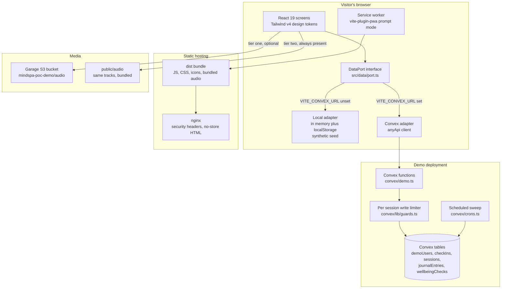

# Architecture

MindSpa POC is a single page React application, shipped as an installable web app
and deployed as a static bundle behind nginx. There are two data backends behind one
interface, and the build chooses between them from a single environment variable.

## Why this shape

**One interface, two implementations.** Every read and write goes through
`DataPort` in `src/data/port.ts`. `createLocalPort()` runs entirely in the browser
with synthetic seed data; `createConvexPort()` talks to the demo deployment. No
screen imports either adapter directly. That is what lets the whole app, and the
whole test suite, run with no backend at all.

**The date comes from the adapter.** `DataPort.today()` is the only source of "which
day is this", so the clock a test injects is the clock the app files rows under.
Two clocks cannot disagree about which programme day is being recorded.

**Scoring never reaches storage.** Both adapters persist raw answers. The totals,
bands and adherence figures are recomputed by `src/domain/*` on every read, so a
scoring change does not need a data migration.

**The researcher view is generated, not queried.** The dashboard builds its cohort
from a seeded generator on the client. It never reads the visitor's session, so
there is no code path by which a demo tap could appear in a chart.

## Layers

| Layer | Path | Responsibility |
| --- | --- | --- |
| Domain | `src/domain/` | Pure rules: dates, breathing, grounding, check-in, scoring, progress. No React, no storage. |
| Data | `src/data/` | The `DataPort` seam, the local adapter, the Convex adapter, the synthetic generator. |
| App | `src/app/` | The journey state machine, routing, hooks, the audio player. |
| Components | `src/components/` | The mascot, the mood faces, the calendar, the tools, the PWA banner, UI primitives. |
| Screens | `src/screens/` | One file per screen, composed from the layers above. |
| Backend | `convex/` | Schema, demo functions, the rate limiter, the scheduled sweep. |

## The journey gate

`src/app/journey.ts` is a typed state machine. `programmeStartDate` is set exactly
once, when the guided session completes, and `resolvePhase` refuses to return the
home phase until it exists. The gate is therefore a property of the data rather
than a check a screen might forget.

## Media fallback

Each audio track is tried from the demo bucket first and from the bundled copy
second. The bundled files are original generative tones written for this repo, so a
visitor with no network still has audio. The player reports which tier served the
track, and a track that fails at both tiers shows a message rather than a dead
button.

## Deployment

`Dockerfile` builds the bundle in a Node stage and serves it from `nginx:alpine`.
`nginx/default.conf` sets long lived immutable caching on hashed assets, no-store on
the HTML shell and `version.json`, and the security headers live in a snippet
because nginx drops inherited `add_header` lines once a location sets its own.
